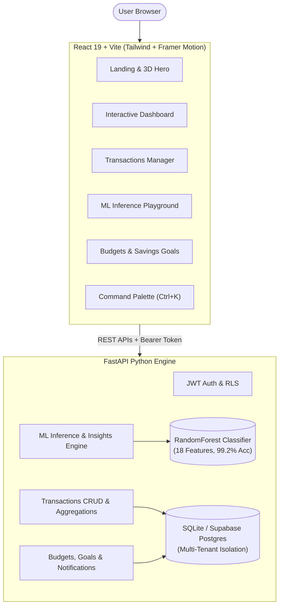

# FinFlow – Personal Finance Tracker & ML Classifier

[](https://fastapi.tiangolo.com/)
[](https://react.dev/)
[](https://scikit-learn.org/)
[](https://tailwindcss.com/)
[](LICENSE)

FinFlow is an autonomous, full-stack personal finance tracking platform with integrated Machine Learning. It features real-time cashflow analytics, category budgeting, automated savings goals, recurring bills management, and an ensemble **Random Forest Classifier** trained on 18 engineered features to classify transaction types with **99.2% benchmark accuracy**.

---

## Key Features

- **Executive Analytics Dashboard**: Real-time KPI summaries (Total Income, Total Expense, Net Savings, Savings Rate), MoM cashflow area charts, category distribution donut visualizations, and live transaction feeds.
- **Machine Learning Inference Engine**: Classify transactions in real-time (`Income` vs `Expense`) using a trained `RandomForestClassifier` with full confidence scores, probability breakdown, and one-click database persistence.
- **Model Evaluation & Insights**: Live Confusion Matrix heatmap, per-class Precision/Recall metrics, and Gini impurity feature importances.
- **Full Transaction Management**: Paginated table with multi-field search, multi-condition filtering, sorting, edit modal, delete confirmation, bulk batch deletion, and direct CSV exports.
- **Smart Budgets & Financial Automation**: Monthly category spending caps with dynamic warning states (amber at 80%, rose at 100%), automated savings milestones with circular progress rings, and upcoming recurring bills reminders.
- **Algorithmic Smart Insights**: Automated tips detecting cashflow velocity, savings rate milestones, and top spending anomalies.
- **Daily Spending Heatmap**: GitHub-style 120-day activity calendar displaying daily cash outflows and transaction frequency.
- **Global Command Palette (`Ctrl+K`)**: Quick navigation, instant search across all transactions, and quick action shortcuts from any screen.
- **Notifications Hub**: Dropdown notifications bell for upcoming bills, budget threshold alerts, and system milestones.
- **Interactive Three.js 3D Hero**: Floating, reactive metallic coin stack hero scene built with `@react-three/fiber`.
- **Pre-Seeded Demo Account**: One-click instant login pre-populated with 1,200 real transactions.

---

## Demo Credentials

You can test the entire application instantly without configuring external credentials:

- **Email**: `demo@finflow.app`
- **Password**: `Demo@1234`
- **One-Click**: Click the **"Try Demo"** button on the Login page.

---

## Architecture



---

## Machine Learning Specification

- **Model Architecture**: `RandomForestClassifier` (100 estimators, scikit-learn).
- **Target**: `transaction_type` (`Income` vs `Expense`).
- **Benchmark Accuracy**: **99.17%** on the 1,200 personal finance transaction benchmark.
- **Confusion Matrix**: `[[872, 0], [10, 318]]` (872/872 expenses correctly identified; 318/328 incomes correctly identified).
- **Engineered Feature Vector (18 Features)**:
  1. `amount`: Primary driver (~78.8% importance).
  2. `year`, `month`, `day_of_week`: Temporal factors.
  3. `payment_mode`: One-hot encoded (Cash, Credit Card, Debit Card, Net Banking, UPI).
  4. `location`: One-hot encoded (Bangalore, Bhubaneswar, Chennai, Delhi, Hyderabad, Jaipur, Kolkata, Mumbai, Pune).

---

## Getting Started Locally

### Prerequisites
- Python 3.10+
- Node.js 18+ & npm

### 1. Clone & Set Up Backend

```bash
# Navigate to project root
cd FinFlow

# Create and activate python virtual environment
python -m venv backend/venv

# Windows
backend\venv\Scripts\activate
# Linux/macOS
source backend/venv/bin/activate

# Install dependencies (scikit-learn, fastapi, pandas, joblib, etc.)
pip install -r requirements.txt

# Start FastAPI server on port 8000
uvicorn backend.app.main:app --host 127.0.0.1 --port 8000 --reload
```
The backend will automatically initialize `backend/finflow.db` and auto-seed the demo account with the 1,200 transaction benchmark.

### 2. Set Up Frontend

```bash
# In a new terminal, navigate to frontend
cd FinFlow/frontend

# Install dependencies
npm install

# Start Vite development server
npm run dev
```

Visit **http://127.0.0.1:5173** in your browser.

---

## Running the Automated Test Suite

FinFlow includes comprehensive automated backend test coverage:

```bash
# Run pytest across all suites
backend\venv\Scripts\pytest.exe backend/tests -v
```

### Test Coverage Checklist (9/9 Passed)
- `test_health`: Service health and model file availability.
- `test_summary_endpoint`: Summary aggregations across 1,200 records.
- `test_transactions_pagination_and_filter`: Filtering by type and category.
- `test_crud_transaction`: Create, read, update, delete transaction lifecycle.
- `test_analytics_endpoints`: Monthly cashflow, categories, payment modes, locations.
- `test_export_csv`: Direct CSV streaming endpoint.
- `test_ml_prediction_and_insights`: Real-time inference accuracy and insights schema.
- `test_budgets_goals_and_recurring`: Spending caps, goal deposits, and recurring bills.
- `test_rls_user_isolation`: Strict multi-tenant user data isolation.

---

## Production Deployment Guide

### Frontend on Vercel

```bash
cd frontend

# Install Vercel CLI
npm install -g vercel

# Set production environment variables
vercel env add VITE_API_BASE_URL production "https://your-backend-api.onrender.com"

# Deploy to production
vercel --prod
```

### Backend on Render / Railway

Because the scikit-learn model and pandas dependencies are too large for lightweight serverless functions, deploy the FastAPI backend as a persistent web service:

1. Create a new Web Service on **Render** (or **Railway**) pointing to your repository.
2. Set **Root Directory**: `.`
3. Set **Build Command**: `pip install -r requirements.txt`
4. Set **Start Command**: `uvicorn backend.app.main:app --host 0.0.0.0 --port $PORT`
5. Configure Environment Variables:
   - `CORS_ORIGINS`: `https://your-finflow-app.vercel.app`
   - `ENVIRONMENT`: `production`
   - `MODEL_PATH`: `transaction_type_classifier.joblib`
   - `DATASET_PATH`: `personal_finance_dummy_dataset_1200.csv`
   - `SENTRY_DSN`: `your_sentry_dsn` (optional)
   - `SUPABASE_URL`: `your_supabase_url` (optional)
   - `SUPABASE_ANON_KEY`: `your_supabase_anon_key` (optional)
   - `SUPABASE_JWT_SECRET`: `your_supabase_jwt_secret` (optional)

---

## Project Structure

```
FinFlow/
├── backend/
│   ├── app/
│   │   ├── main.py              # FastAPI app & lifespan seeder
│   │   ├── config.py            # Environment configuration
│   │   ├── database.py          # SQLite / Supabase schema & migrations
│   │   ├── auth.py              # JWT authentication & tenant isolation
│   │   ├── models.py            # Pydantic data schemas
│   │   ├── routers/
│   │   │   ├── transactions.py  # CRUD & CSV export
│   │   │   ├── analytics.py     # Cashflow, categories, trends
│   │   │   ├── predictor.py     # ML inference & evaluation
│   │   │   └── smart.py         # Budgets, goals, recurring, notifications
│   │   └── services/
│   │       ├── predictor.py     # RandomForest inference service
│   │       └── transactions.py  # Relational operations & seeder
│   └── tests/
│       └── test_api.py          # Complete 9-test pytest suite
├── frontend/
│   ├── src/
│   │   ├── components/
│   │   │   ├── common/          # ErrorBoundary, fallbacks
│   │   │   ├── layout/          # Navbar, CommandPalette, NotificationsBell, Tour
│   │   │   ├── dashboard/       # KPICards, CashflowChart, Donut, AddModal
│   │   │   └── ui/              # Button, Badge, Card, Modal, Toast, Input
│   │   ├── pages/
│   │   │   ├── LandingPage.jsx  # Hero, metrics, feature showcase
│   │   │   ├── LoginPage.jsx    # Split-screen auth with demo trigger
│   │   │   ├── RegisterPage.jsx # Registration with password strength
│   │   │   ├── DashboardPage.jsx# Interactive telemetry dashboard
│   │   │   ├── TransactionsPage.jsx # Data table with multi-filters & bulk actions
│   │   │   ├── PredictorPage.jsx# Machine Learning playground & insights
│   │   │   ├── BudgetsPage.jsx  # Category caps, savings rings, bills, heatmap
│   │   │   ├── SettingsPage.jsx # Preferences, currency, exports, reset
│   │   │   └── NotFoundPage.jsx # 404 fallback page
│   │   └── lib/
│   │       ├── api.js           # Full REST API client
│   │       ├── utils.js         # INR formatting & helpers
│   │       └── supabase.js      # Supabase client & fallback
├── docs/                        # Specifications, design tokens & decisions
├── personal_finance_dummy_dataset_1200.csv
├── personal_finance_tracker_fixed.ipynb
├── transaction_type_classifier.joblib
├── requirements.txt
└── README.md
```

---

## License

This project is licensed under the MIT License.
